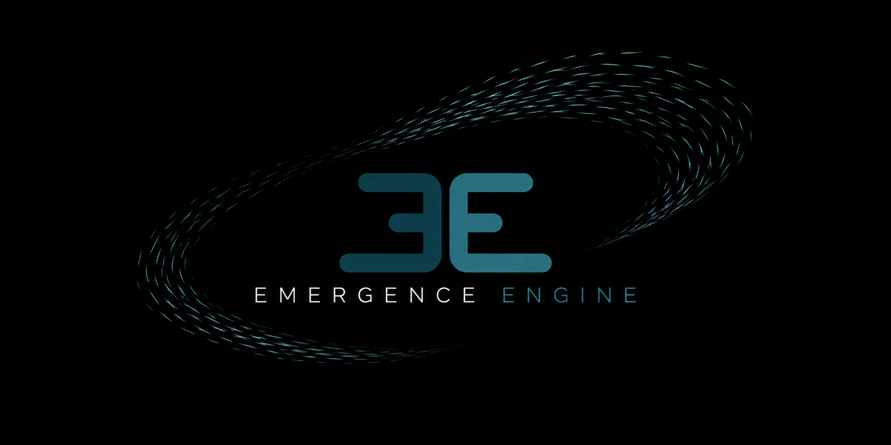
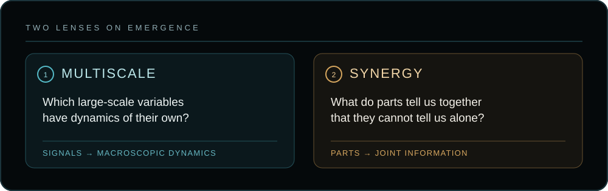
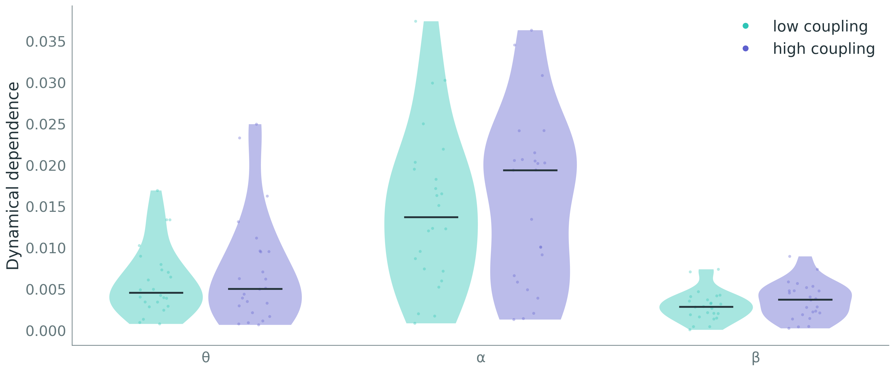
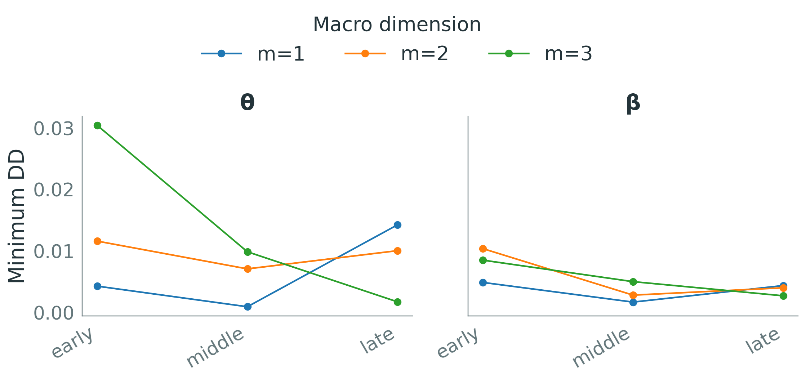
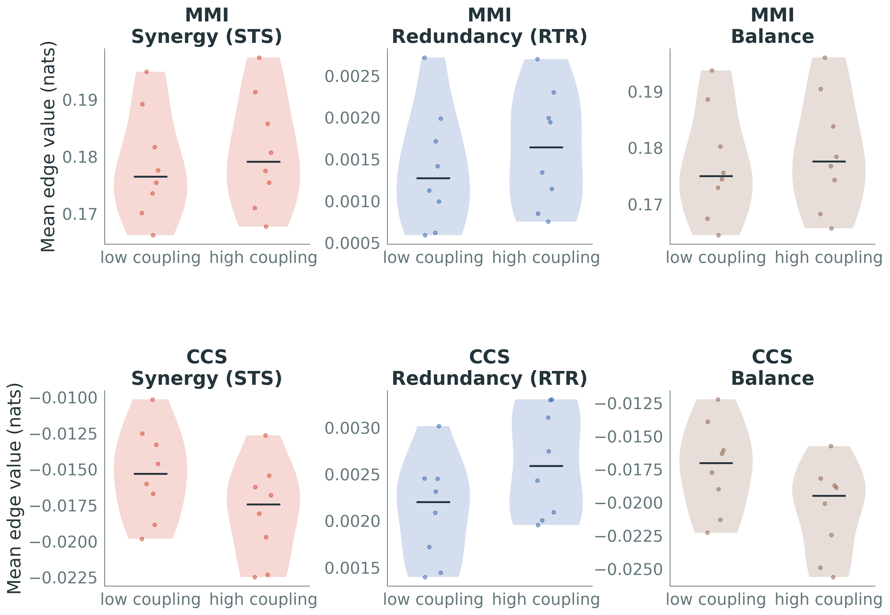
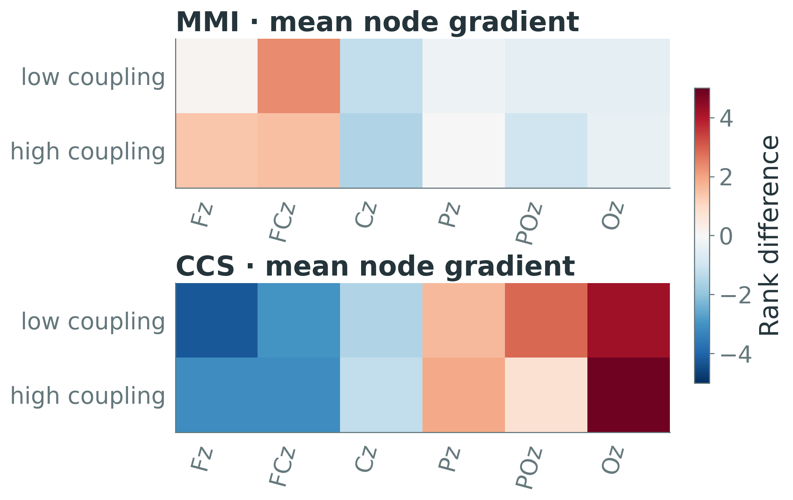

<p align="center">
  
</p>

<p align="center">
  <em>Two complementary questions about emergence in complex dynamics.</em><br>
  <a href="#multiscale-emergence">Multiscale</a> ·
  <a href="#synergy">Synergy</a> ·
  <a href="#cite-this-toolbox">Citation</a>
</p>

---

Emergence Engine brings two standalone Python packages together to study
emergence in time-series data. Both work with your preprocessed signals, and
each has a short notebook to help you begin.

## Explore the engine



To read a Markdown guide with rendered equations and diagrams in your default
browser, run this from the repository root (requires Pandoc):

```bash
./scripts/open-md multiscale/STATE_SPACE_FITTING.md
```

| **Multiscale** | **Synergy** |
|:--|:--|
| **Which coarse-grained variables emerge in high-dimensional dynamics?** | **What information do wholes carry that their parts alone do not?** |
| Find macroscopic variables whose dynamics are relatively independent of the microscopic system. | Decompose information carried jointly by variables into redundant, unique, and synergistic contributions. |
| [Read the guide](multiscale/README.md) · [Open the quickstart](multiscale/notebooks/quickstart.ipynb) | [Read the guide](synergy/README.md) · [Open the quickstart](synergy/notebooks/quickstart.ipynb) |

## Analyses and figures

These examples come from a reproducible **six-node VAR(2) toy model**, analysed
with the toolkit itself. Eight simulated subjects share their innovations
across low- and high-coupling conditions. The plots show what the analysis
functions produce; they are not empirical results or significance claims.
Run [the showcase script](examples/build_showcase.py) to regenerate them, or
open the [complete figure gallery](VISUALISATION.md) for more plots and the
figure-function catalogue.

### Multiscale · dynamical dependence

Across frequency bands, compare how much dynamical dependence remains in the
best coarse-grained variables. Each point is a fitted simulated recording;
the horizontal marks show medians. [Open the PDF](assets/showcase/multiscale-dd.pdf).



### Multiscale · changing dynamics

Fit the VAR model and optimise DD separately in successive windows to trace
the best one-, two-, and three-dimensional macroscopic variables.
[Open the PDF](assets/showcase/multiscale-windows.pdf).



### Synergy · information atoms

Decompose lagged information for pairs of nodes, then compare the distribution
of synergistic, redundant, and balance summaries for MMI and CCS estimators.
[Open the PDF](assets/showcase/synergy-atoms.pdf).



### Synergy · regional gradients

The nodal map ranks each node's synergy against its redundancy, showing how
the spatial pattern differs between estimators and coupling conditions.
[Open the PDF](assets/showcase/synergy-nodes.pdf).



## Multiscale emergence

**Which coarse-grained variables emerge in high-dimensional dynamics?** A
macroscopic variable can be constructed from many microscopic signals. If
its own past predicts its future almost as well as the full system's past, it
has a degree of **dynamical independence** (DI). The toolbox searches for such
variables by minimising **dynamical dependence** (DD) across dimensions. It
fits VAR models or directly estimates innovations state-space models by CCA.
The [state-space fitting guide](multiscale/STATE_SPACE_FITTING.md) explains the
procedure, notation, and MVGC2 parity. It computes DD in the time domain, in frequency bands, or in
successive recording windows to follow *time-changing DD*. It also describes
the structure and fragmentation of the optimised solutions.

These ideas run through our work on
[emergent structure in biophysical neural models](https://doi.org/10.1371/journal.pcbi.1012572)
and [multiscale neural dynamics in anaesthesia](https://doi.org/10.1162/IMAG.a.1364).
The implementation draws on Barnett and Seth's
[SSDI toolbox](https://github.com/lcbarnett/ssdi) and
[dynamical independence paper](https://doi.org/10.1103/PhysRevE.108.014304),
and on the [MVGC2 toolbox](https://github.com/lcbarnett/MVGC2) and
[MVGC toolbox paper](https://doi.org/10.1016/j.jneumeth.2013.10.018).

```bash
python -m pip install ./multiscale
```

Start with the [Multiscale guide](multiscale/README.md) or its
[quickstart notebook](multiscale/notebooks/quickstart.ipynb). For group tables
and figures, install `./multiscale[plots]`.

> **A note on fMRI:** DD/DI on BOLD recordings should currently be treated as
> exploratory. Slow sampling and assumptions about the haemodynamic response
> can distort predictive relationships. See the
> [fMRI guidance](multiscale/README.md#fmri-use-particular-caution) before
> interpreting a result as neural-level DI.

## Synergy

**What information do wholes carry that their parts alone do not?** Synergy
looks at information shared by collections of variables across time.
Its ΦID engine decomposes information into 16 atoms, including redundant,
unique, and synergistic contributions. The package also has general subject
summaries, group statistics, and figures. Your cohorts and node labels can be
whatever your study needs.

**Ways to compute ΦID**

| Measure | Discrete states | Continuous signals (Gaussian) |
|:--|:--:|:--:|
| MMI | ✓ | ✓ |
| CCS | ✓ | ✓ |
| Shared exclusions (`Iτ-sx`) | ✓ | ✗ |
| Proposed two-sided Gaussian SX extension | ✗ | ✓ Experimental |

✓ means the measure is implemented; ✗ means it is unavailable for that input
type. The Gaussian SX extension is an exploratory implementation with a
specified scale convention, not a continuous version of the established
discrete `Iτ-sx` measure. The [Synergy guide](synergy/README.md#phi_id-engine)
shows the exact API calls, input requirements, and units. Full decompositions
accept either a `variables × time` series or four explicit past/future arrays;
`pairwise_atoms` computes continuous MMI and CCS matrices across many nodes.

```bash
python -m pip install './synergy[analysis]'
```

The lighter core installs with `python -m pip install ./synergy`; add the `fast`
extra for accelerated pairwise calculations. The retained AAL90 DoC figure
workflow uses the `doc` extra and separate atlas assets. The
[Synergy guide](synergy/README.md) and
[quickstart notebook](synergy/notebooks/quickstart.ipynb) walk through a
complete analysis. The original ΦID computation was extracted from Pedro
Mediano's MATLAB toolboxes.

## Bring your own signals

Both packages expect **preprocessed time series**. Multiscale takes
`nodes × samples [× trials]`; Synergy's pairwise API takes `nodes × samples`.
Keep node order, preprocessing, and sampling choices comparable across
subjects and conditions. Neither package can decide these scientific choices
for you (tempting as that would be).

- **EEG:** document the montage or source space, reference, artefacts,
  filtering, epoch selection, sampling rate, and any downsampling. Consider
  volume conduction and source leakage when interpreting relations between
  nodes.
- **fMRI:** document the parcellation, ROI order, motion and nuisance handling,
  filtering, TR, and whether signals are BOLD or HRF-deconvolved. The
  Multiscale fMRI caution above is particularly important for DI.

## Papers behind this project

- **Barnett, L., & Seth, A. K.** (2023). “Dynamical independence:
  Discovering emergent macroscopic processes in complex dynamical systems.”
  *Physical Review E, 108*, 014304.
  [doi:10.1103/PhysRevE.108.014304](https://doi.org/10.1103/PhysRevE.108.014304).
- **Mediano, P. A. M., Rosas, F. E., Luppi, A. I., Carhart-Harris, R. L.,
  Bor, D., Seth, A. K., & Barrett, A. B.** (2025). “Toward a unified taxonomy
  of information dynamics via Integrated Information Decomposition.”
  *Proceedings of the National Academy of Sciences, 122*(39), e2423297122.
  [doi:10.1073/pnas.2423297122](https://doi.org/10.1073/pnas.2423297122).
- **Milinkovic, B., Barnett, L., Carter, O., Seth, A. K., & Andrillon, T.**
  (2025). “Capturing the emergent dynamical structure in biophysical neural
  models.” *PLOS Computational Biology, 21*(5), e1012572.
  [doi:10.1371/journal.pcbi.1012572](https://doi.org/10.1371/journal.pcbi.1012572).
- **Milinkovic, B., Seth, A. K., Barnett, L., Carter, O., & Andrillon, T.**
  (2026). “Emergent multiscale organisation of neural dynamics fragments in
  anaesthesia.” *Imaging Neuroscience, 4*, IMAG.a.1364.
  [doi:10.1162/IMAG.a.1364](https://doi.org/10.1162/IMAG.a.1364).

## Licence

Copyright © 2026 Borjan Milinkovic. Synergy is [MIT licensed](synergy/LICENSE).
Multiscale is [GPL-3.0-only](multiscale/LICENSE) because it adapts routines
from MVGC2; see its [source attribution](multiscale/NOTICE.md).

## Cite this toolbox

**If you use Emergence Engine, please cite the software** using the repository's
[CITATION.cff](CITATION.cff) (GitHub's “Cite this repository” button), and cite
the relevant papers above for the methods and applications you use. Until a
release DOI is minted, the citation points to this GitHub repository. Please
include the version or commit you used so someone else can reproduce your run!!
