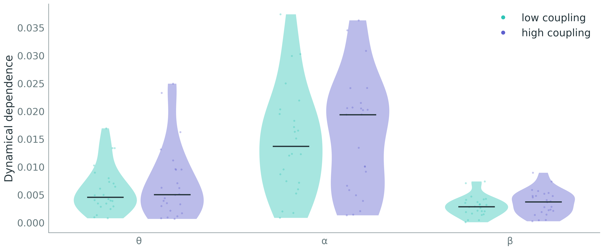
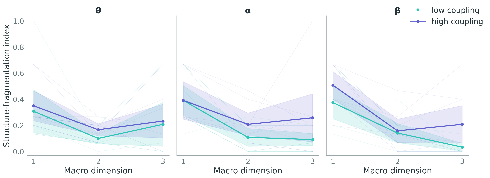
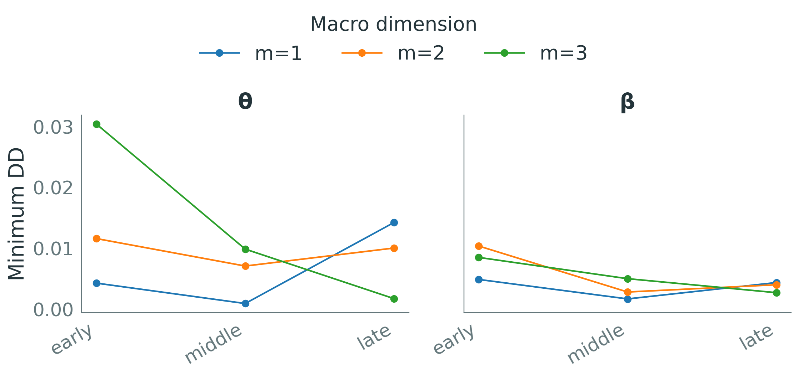
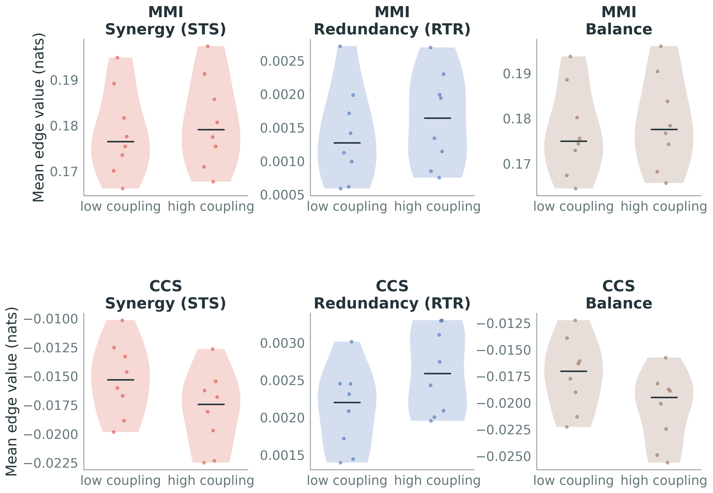
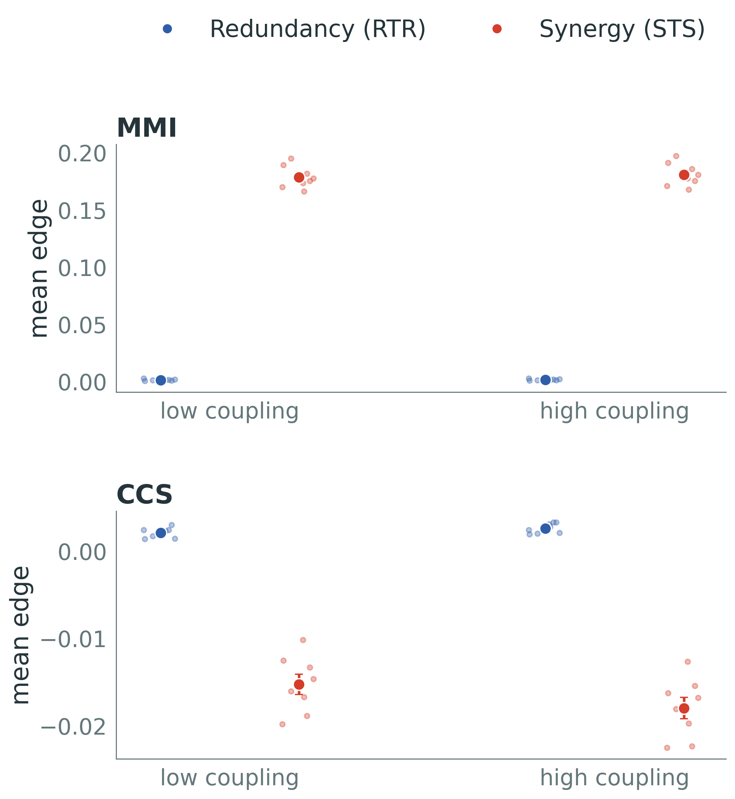
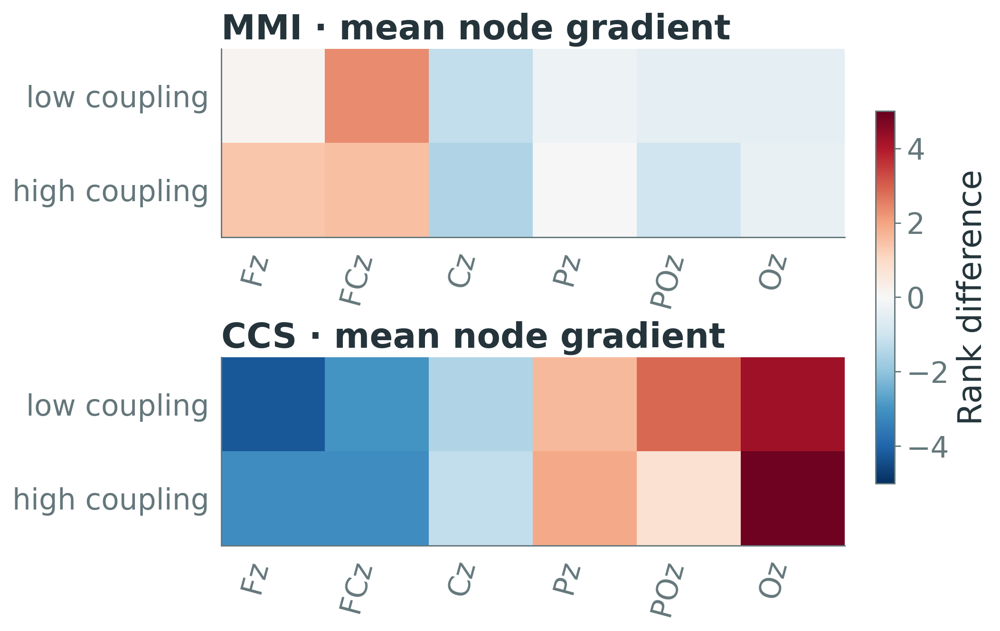

# Figure gallery and visualisation

Every figure below is generated by [the reproducible showcase script](examples/build_showcase.py)
from simulated signals of a stable six-node VAR(2) system. The same signals go
through VAR fitting, spectral dynamical dependence optimisation, and Gaussian
pairwise ΦID. Eight paired simulated subjects differ in cross-node coupling;
the time-window example uses three successive coupling levels. These are
demonstrations of the analysis pipeline, not empirical findings. No
significance tests are shown.

To rebuild the gallery after installing `./multiscale[plots]` and
`./synergy[analysis]`:

```bash
python examples/build_showcase.py
```

The toy recordings have 720 samples per subject at 64 Hz. DD uses six search
starts and 30 iterations per optimisation stage, enough for an API example;
research analyses should assess convergence with more restarts. Pairwise ΦID
uses a one-sample lag. The script, model coefficients, and random seed are all
in the repository.

## Multiscale

### Dynamical dependence by band

Best DD across theta, alpha, and beta bands, pooled over macro dimensions.
[PDF](assets/showcase/multiscale-dd.pdf) · [SVG](assets/showcase/multiscale-dd.svg)



### Structure and fragmentation

The SF index measures the fraction of optimised subspace pairs whose distance
falls below the stated threshold (0.2 in this demo). Lines show subject paths;
larger marks and ribbons show mean and SEM.
[PDF](assets/showcase/multiscale-sf.pdf) · [SVG](assets/showcase/multiscale-sf.svg)



### DD across recording windows

Each window has its own fitted VAR and DD optimisation.
[PDF](assets/showcase/multiscale-windows.pdf) · [SVG](assets/showcase/multiscale-windows.svg)



## Synergy

### Global atom summaries

Subject-level distributions of synergy (STS), redundancy (RTR), and their
balance, calculated with MMI and CCS.
[PDF](assets/showcase/synergy-atoms.pdf)



### Paired atom comparisons

Within each coupling condition, dots show subject values and larger marks
show the mean and standard error for RTR and STS.
[PDF](assets/showcase/synergy-paired.pdf)



### Node-wise synergy–redundancy gradient

The colour bar shows the difference between synergy and redundancy ranks at
each node. The channel-like labels illustrate the node-order contract; these
are simulated signals, not recorded EEG.
[PDF](assets/showcase/synergy-nodes.pdf)



## Figure functions

| Analysis | Figure function | What it shows |
|:--|:--|:--|
| DD by macro dimension and band | `plot_dd_violin_by_macro` | Subject distributions for two conditions |
| Pooled DD by band | `plot_dd_grand_average` | Overall condition comparison |
| Structure and fragmentation | `plot_sf_index`, `plot_similarity_matrices` | Group trajectories and distances among optimised subspaces |
| Time-changing DD and SF | `plot_time_changing_dd`, `plot_timewindow_dd`, `plot_timewindow_sf` | Trends and condition comparisons over fitted windows |
| State comparisons | `plot_state_trajectory`, `plot_pairwise_heatmap` | Ordered state trajectories and pairwise effects |
| ΦID atoms and graph summaries | `plot_global_atoms`, `plot_atom_pairs` | Atom distributions, paired summaries, graph efficiency or modularity |
| Nodal and system gradients | `plot_node_gradients`, `plot_system_gradients` | Synergy versus redundancy across nodes and named systems |
| Regional group effects | `plot_regional_effects` | Corrected node-wise contrasts when inference is supplied |
| Similarity to a reference network | `plot_atom_pairs(reference=...)` | Atom–connectivity Spearman correlation |

The Multiscale functions live in `multiscale.visualisation`; the general
Synergy functions live in `synergy.plotting.general`. Synergy's
`render_figures` selects the applicable panels from an `AnalysisResult`, and
the retained DoC cortical-surface workflow requires its own atlas and data.

## Figure style and exports

Emergence Engine figures use large publication typography, open backgrounds
without grid lines, and vector-friendly exports. The colors retain their
scientific meanings.

| Figure family | Color meaning | Default exports |
|:--|:--|:--|
| Multiscale group comparisons | Teal and violet distinguish the two conditions. Most plotting functions accept `colours=` (or `colors=`). | PDF, PNG, SVG |
| Synergy atom summaries | Blue is redundancy (RTR), red is synergy (STS), and brown is their balance. | PNG and PDF; add SVG with `formats=("png", "pdf", "svg")` |
| Signed heatmaps | Blue and red show opposite sides of zero. Color bars retain the quantitative scale. | As above |

The retained DoC cortical and regional figure presets keep their existing
anatomical and atom palettes. They are a separate, dataset-specific workflow.

The general plotting APIs apply their style only while a figure is built or
saved. Calling one figure function does not change the Matplotlib settings of
the rest of a notebook. The dataset-specific DoC command keeps its original
figure layouts and colors.

## Make a Multiscale figure

```python
from multiscale.visualisation import plot_dd_violin_by_macro

plot_dd_violin_by_macro(
    all_dd, stats, "figures/dd_by_dimension",
    conditions=("control", "practice"),
)
```

The output stem produces `dd_by_dimension.pdf`, `.png`, and `.svg`. The
function returns the PDF path. See the [Multiscale guide](multiscale/README.md)
for the table shapes and analysis steps that produce `all_dd` and `stats`.

## Make Synergy figures

```python
from synergy.plotting.general import render_figures

render_figures(
    analysis, "figures/synergy", inference=inference,
    formats=("png", "pdf", "svg"),
)
```

The renderer creates only panels supported by the supplied analysis data. See
the [Synergy guide](synergy/README.md) for its subject-level input contract and
optional atlas-specific workflow.

Keep figure captions explicit about the estimator, units, sample size,
preprocessing, comparison, and correction used. Color supports the reading of a
figure; labels and legends must still identify the quantities being compared.
