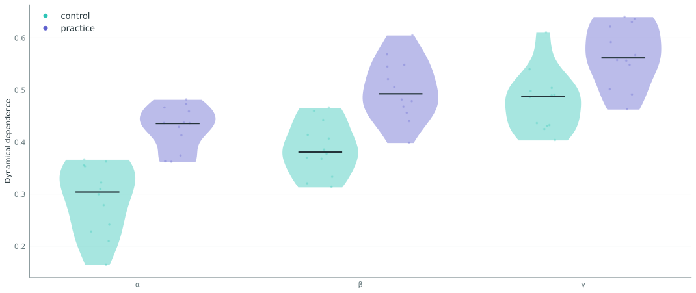
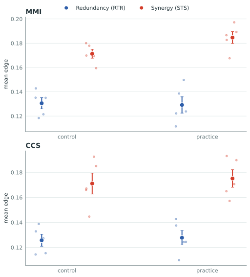

# Visualisation

Emergence Engine figures use a common publication style: quiet axes, light
reference grids, legible labels, and vector-friendly exports. The colors still
carry the same scientific meanings as before.

| Figure family | Color meaning | Default exports |
|:--|:--|:--|
| Multiscale group comparisons | Teal and violet distinguish the two conditions. Most plotting functions accept `colours=` (or `colors=`). | PDF, PNG, SVG |
| Synergy atom summaries | Blue is redundancy (RTR), red is synergy (STS), and brown is their balance. | PNG and PDF; add SVG with `formats=("png", "pdf", "svg")` |
| Signed heatmaps | Blue and red show opposite sides of zero. Color bars retain the quantitative scale. | As above |

The retained DoC cortical and regional figure presets keep their existing
anatomical and atom palettes. They are a separate, dataset-specific workflow.

The general plotting APIs apply their style only while a figure is built or
saved. Calling one figure function does not change the Matplotlib settings of
the rest of a notebook. The dataset-specific DoC command uses its own plotting
process and style.

## Figure examples

These examples use **synthetic data** to show the output style; they are not
scientific results. Rebuild them with
[`examples/build_figure_gallery.py`](examples/build_figure_gallery.py).

**Multiscale · dynamical dependence by frequency band**



**Synergy · redundancy and synergy by group**



## Make a Multiscale figure

```python
from multiscale.visualisation import plot_dd_violin_by_macro

plot_dd_violin_by_macro(
    all_dd, stats, "figures/dd_by_dimension",
    conditions=("control", "practice"),
)
```

The output stem produces `dd_by_dimension.pdf`, `.png`, and `.svg`. The
function returns the PDF path. See the [Multiscale guide](multiscale/README.md)
for the table shapes and analysis steps that produce `all_dd` and `stats`.

## Make Synergy figures

```python
from synergy.plotting.general import render_figures

render_figures(
    analysis, "figures/synergy", inference=inference,
    formats=("png", "pdf", "svg"),
)
```

The renderer creates only panels supported by the supplied analysis data. See
the [Synergy guide](synergy/README.md) for its subject-level input contract and
optional atlas-specific workflow.

Keep figure captions explicit about the estimator, units, sample size,
preprocessing, comparison, and correction used. Color supports the reading of a
figure; labels and legends must still identify the quantities being compared.
