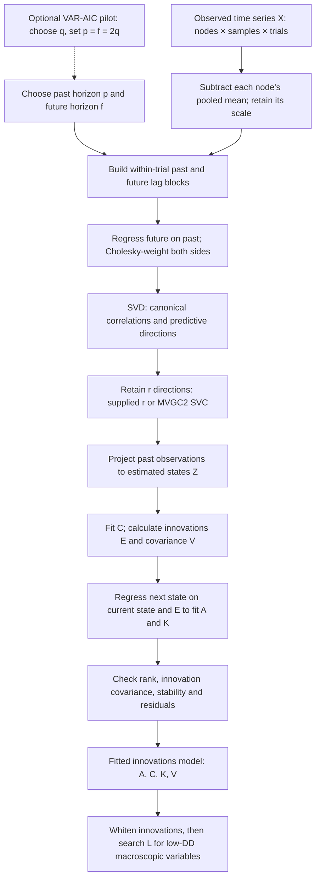

# Fitting state-space models directly from time series

**Which coarse-grained variables emerge in high-dimensional dynamics?** Before
we search for those variables, we need a model of the microscopic dynamics.
We can now fit that model directly in innovations state-space form.

Previously, this toolbox fitted a VAR and converted it into a companion
state-space representation. The new `tsdata_to_ss` route estimates a latent
state from the observed time series using MVGC2's canonical correlations
analysis (CCA) subspace method. The existing VAR route remains available.

## Our notation

We distinguish the observed microscopic process, the fitted predictive state,
and the macroscopic variable we later search for:

| Symbol | Meaning | Size |
|:--|:--|:--|
| $X_t$ | Centred microscopic observation at time $t$ | $n$ |
| $Z_t$ | Latent predictive state fitted from past observations | $r$ |
| $E_t$ | Observation innovation | $n$ |
| $V$ | Innovation covariance | $n\times n$ |
| $A,C,K$ | State transition, observation, innovation-gain matrices | $r\times r$, $n\times r$, $r\times n$ |
| $p,f$ | Past and future CCA horizons, in samples | Positive integers |
| $q$ | VAR order, when using a VAR pilot | Nonnegative integer |
| $L$ | Projection defining a macroscopic variable | $n\times m$ |
| $Y_t=L^\top X_t$ | Macroscopic observation | $m<n$ |

The fitted innovations model is

$$
Z_{t+1}=AZ_t+KE_t,\qquad X_t=CZ_t+E_t,\qquad
\operatorname{cov}(E_t)=V.
$$

The state dimension $r$ describes predictive memory. The macro dimension $m$
describes the coarse-grained observation we search for. These are different
choices: the fitted state $Z_t$ is not itself evidence of an emergent macro.
We assess dynamical independence when we subsequently optimise $L$.

The input array is `nodes × samples [× trials]`. “Direct from time series”
means no fitted VAR is required when horizons are supplied. It does not mean
that the estimator performs acquisition cleaning, artefact removal, or
stationarity correction. Give it finite observations in a common node order.

## The fitting schematic



## What happens at each step

### 1. Centre the microscopic observations

For each node we subtract one mean pooled across time and trials. We do not
standardise its variance. Trials are treated as repeated realisations of one
process; no past or future block crosses a trial boundary. The fitted result
stores `mean` so predictions can be returned to the original observation scale.

### 2. Build a past and a future around each time point

For a trial of length $T$, the paired blocks are

$$
P_t=[X_{t-1}^\top,\ldots,X_{t-p}^\top]^\top,\qquad
F_t=[X_t^\top,\ldots,X_{t+f-1}^\top]^\top.
$$

There are $T-p-f+1$ paired columns per trial. With $N$ trials, let
$M_h=N(T-p-f+1)$. We concatenate valid columns across trials, preserving
MVGC2's ordering. The past block used to reconstruct states extends to the
end of each trial, giving $T-p+1$ states per trial.

Long horizons expose longer predictive memory but increase the covariance
matrix dimensions to $np$ and $nf$. If those matrices are rank deficient,
the fit stops with a clear error; it does not silently add a ridge penalty.

### 3. Find the predictive directions by CCA

Let $W_pW_p^\top=PP^\top/M_h$ and
$W_fW_f^\top=FF^\top/M_h$. First regress future on past,
$B=FP^\dagger$, then compute

$$
W_f^{-1}BW_p=U\Sigma R^\top.
$$

The singular values describe canonical correlations between the past and
future blocks. Keeping $r$ directions gives estimated predictive states

$$
\widehat Z=\Sigma_r^{1/2}R_r^\top W_p^{-1}P_{\mathrm{extended}}.
$$

This whitening belongs to the CCA calculation. It is distinct from the
innovation whitening used later by the DD objectives.

### 4. Choose how many states to retain

Pass `r=` when the state dimension is specified. Otherwise we reproduce
MVGC2's SVC calculation. Set $r_{\max}=n\min(p,f)$ and let
$\sigma_1,\ldots,\sigma_{r_{\max}}$ be the CCA singular values. Its source
constructs the scores

$$
s_j=-\log(1-\sigma_{j+1})+2nj\frac{\log M_h}{M_h},
\quad j=1,\ldots,r_{\max},\quad\sigma_{r_{\max}+1}=0.
$$

**Parity detail:** the reference maps the minimum score at one-based index
$j$ to selected order $r=j-1$. It uses unsquared singular values. We preserve
both conventions, rather than silently changing the reference criterion.
Consequently SVC selects among `0 .. rmax-1`; an explicitly supplied order may
reach `rmax`. A selected zero is returned by `tsdata_to_ssmo`, but the fitting
function raises an error because its downstream DD path requires a dynamic
state. It does not replace zero with one.

`fit_ss_auto(X)` optionally obtains a VAR-AIC pilot order $q$ and sets
$p=f=2q$. This pilot chooses horizons only; CCA still fits the final state-space
model directly from observations. Pass `pf=` to skip the pilot entirely.

### 5. Fit the observation and state equations

Using aligned observations and current states, least squares gives

$$
\widehat C=X\widehat Z^\dagger,\qquad
\widehat E=X-\widehat C\widehat Z,\qquad
\widehat V=\frac{\widehat E\widehat E^\top}{N(T-p)-1}.
$$

Regressing next states on current states and innovations gives

$$
[\widehat A\;\widehat K]
=\widehat Z_{\mathrm{next}}
\begin{bmatrix}\widehat Z_{\mathrm{current}}\\\widehat E\end{bmatrix}^{\dagger}.
$$

This is MVGC2's regression estimate of $K$. There is no additional Riccati
solve in the fitting procedure. The Riccati solve enters later when evaluating
temporal DD for a macroscopic projection. A general state-space model with
separate process and observation noise covariances is a different
parameterisation from the innovations model fitted here.

### 6. Assess the fit before interpreting a macro

`fit.diagnostics` reports the spectral radii of $A$ and $A-KC$, and the smallest
eigenvalue of $V$. For a stable, minimum-phase innovations model, both radii
should be below one and $V$ should be positive definite. Finite-sample CCA
regressions do not enforce these properties. The fitter reports the model;
`prepare_ss` rejects unstable state or predictor dynamics before DD analysis.

Also examine innovations for remaining autocorrelation and compare prediction
errors on held-out recordings. These diagnostics are part of assessing a fit;
a small training error alone does not validate a state dimension or horizon.
For filtering new observations, initialise a state and iterate
$\widehat E_t=(X_t^{\mathrm{raw}}-\mu)-C\widehat Z_t$ and
$\widehat Z_{t+1}=A\widehat Z_t+K\widehat E_t$. The returned training states
are CCA projections; they are not an independent held-out prediction test.

## Use it in the toolbox

```python
from multiscale import tsdata_to_ss, tsdata_to_ssmo, fit_ss_auto

# X: your prepared nodes × samples [× trials] array
fit = tsdata_to_ss(X, pf=(10, 10), r=4)
print(fit.A.shape, fit.C.shape, fit.K.shape, fit.V.shape)
print(fit.diagnostics)

# Inspect the reference SVC selection, or use it to fit.
selection = tsdata_to_ssmo(X, pf=(10, 10))
fit_svc = tsdata_to_ss(X, pf=(10, 10))  # may reject selected order zero

# Optional VAR-AIC horizon pilot, followed by a direct CCA fit.
fit_auto = fit_ss_auto(X, pmax=20)
```

The result contains `A`, `C`, `K`, `V`, `states`, `residuals`, `mean`, `order`,
and `selection`. States have shape `(r, T-p+1, N)` and innovations
`(n, T-p, N)`. Both retain a trials axis even for a single recording.
The last estimated state is for the next time point beyond the recording;
there is no matching observed innovation for that last state.

For full-spectrum or temporal DD:

```python
from multiscale import random_initial_bases, run_full_dd_ss

starts = random_initial_bases(X.shape[0], 2, runs=20, seed=7)
result = run_full_dd_ss(fit, fs=64, fres=128, initial_bases=starts,
                        final_method="both", seed=7)
```

The adapter factors $V=RR^\top$, transforms observations by $R^{-1}$, and uses
$C_w=R^{-1}C$, $K_w=KR$ with unit innovation covariance. It then uses the
existing DD optimisers. The returned `*_original_bases` pull macro projections
back to the original observation coordinates. The existing
`run_grid_parallel` and `run_time_changing_dd` convenience functions still fit
or accept VAR models; this new direct-SS entry point is `run_full_dd_ss`.

## Reference and numerical parity

The port follows MVGC2 at commit
[`89be6b67f0f5e8697da333467ce41877d37e8421`](https://github.com/lcbarnett/MVGC2/tree/89be6b67f0f5e8697da333467ce41877d37e8421),
specifically `core/tsdata_to_ss.m`, `core/tsdata_to_ssmo.m`, and `stats/demean.m`.
See [NOTICE.md](NOTICE.md) for attribution and GPL licensing.

The reference MATLAB sources were executed with GNU Octave on the same
simulated innovations process for a single trial and three trials. Tests
compare innovations, covariance, transfer functions, selected orders, and
state parameters after accounting for the arbitrary state-coordinate
transformation. Raw SVD signs are not a scientific difference between fits.
See [the parity record](validation/SS_PARITY.md), the stored fixtures, and
[the tests](tests/test_ss_fit.py). This establishes numerical parity for those
cases, not universal equivalence on every ill-conditioned dataset.
