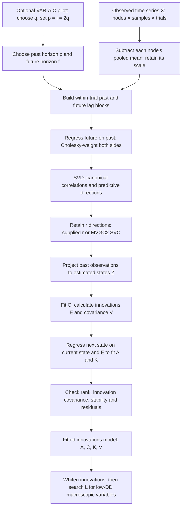

# Fitting state-space models directly from time series

**Which coarse-grained variables emerge in high-dimensional dynamics?** Before
we search for those variables, we need a model of the microscopic dynamics.
We can now fit that model directly in innovations state-space form.

Previously, this toolbox fitted a VAR and converted it into a companion
state-space representation. The new `tsdata_to_ss` route estimates a latent
state from the observed time series using MVGC2's canonical correlations
analysis (CCA) subspace method. The existing VAR route remains available.

## Our notation

We distinguish the observed microscopic process, the fitted predictive state,
and the macroscopic variable we later search for:

| Symbol | Meaning | Size |
|:--|:--|:--|
| $X_t$ | Centred microscopic observation at time $t$ | $n$ |
| $Z_t$ | Latent predictive state fitted from past observations | $r$ |
| $E_t$ | Observation innovation | $n$ |
| $V$ | Innovation covariance | $n\times n$ |
| $A,C,K$ | State transition, observation, innovation-gain matrices | $r\times r$, $n\times r$, $r\times n$ |
| $p,f$ | Past and future CCA horizons, in samples | Positive integers |
| $q$ | VAR order, when using a VAR pilot | Nonnegative integer |
| $L$ | Projection defining a macroscopic variable | $n\times m$ |
| $Y_t=L^\top X_t$ | Macroscopic observation | $m<n$ |

The fitted innovations model is

$$
Z_{t+1}=AZ_t+KE_t,\qquad X_t=CZ_t+E_t,\qquad
\operatorname{cov}(E_t)=V.
$$

The state dimension $r$ describes predictive memory. The macro dimension $m$
describes the coarse-grained observation we search for. These are different
choices: the fitted state $Z_t$ is not itself evidence of an emergent macro.
We assess dynamical independence when we subsequently optimise $L$.

The input array is `nodes × samples [× trials]`. “Direct from time series”
means no fitted VAR is required when horizons are supplied. It does not mean
that the estimator performs acquisition cleaning, artefact removal, or
stationarity correction. Give it finite observations in a common node order.

## From an original state-space model to innovations form

This derivation starts with a **known** linear stochastic model. It explains
what the innovations parameters mean. The direct time-series fitter below
does **not** first estimate $F,H,Q,R,S$ and then run this Riccati calculation.

Let $\xi_t$ be a physical or mechanistic hidden state. Write the original
model, with zero-mean disturbances white across time, as

$$
\xi_{t+1}=F\xi_t+W_t,\qquad X_t=H\xi_t+N_t,
\qquad
\operatorname{cov}\!\begin{pmatrix}W_t\\N_t\end{pmatrix}
=\begin{pmatrix}Q&S\\S^\top&R\end{pmatrix}.
$$

The cross-covariance $S$ allows process and measurement disturbances at the
**same** time to be correlated. If they are independent, $S=0$. Let
$\mathcal I_{t-1}$ be the observations strictly before $t$, and define the
optimal **linear** one-step predicted state and its error covariance by

$$
Z_t=\operatorname{Proj}_{\rm lin}(\xi_t\mid\mathcal I_{t-1}),\qquad
\Pi=\operatorname{cov}(\xi_t-Z_t).
$$

For Gaussian disturbances this linear projection is the conditional mean.

The innovation is the part of the current observation absent from that past:

$$
E_t=X_t-HZ_t=H(\xi_t-Z_t)+N_t,
\qquad V=\operatorname{cov}(E_t)=H\Pi H^\top+R.
$$

Now predict the next hidden state. Before conditioning on $E_t$, its error is
$F(\xi_t-Z_t)+W_t$. Its cross-covariance with $E_t$ is

$$
G=\operatorname{cov}\bigl(F(\xi_t-Z_t)+W_t,E_t\bigr)
=F\Pi H^\top+S.
$$

Linear least-squares conditioning therefore adds $G V^{-1}E_t$ to the
prediction. In the stationary case this gives

$$
K=GV^{-1},\qquad
Z_{t+1}=FZ_t+KE_t,\qquad X_t=HZ_t+E_t.
$$

The conditional error covariance must reproduce itself one step later. This
is the discrete algebraic Riccati equation:

$$
\boxed{\Pi=F\Pi F^\top+Q
 -(F\Pi H^\top+S)(H\Pi H^\top+R)^{-1}
 (F\Pi H^\top+S)^\top.}
$$

Solving its stabilising branch gives the innovations representation
$(A,C,K,V)=(F,H,GV^{-1},H\Pi H^\top+R)$. The state $Z_t$ is a
**predictor** of $\xi_t$, rather than the physical state itself. Under the
usual observability and noise conditions, $E_t$ is orthogonal to all earlier
observations. With Gaussian disturbances it is also independent of them.

### A scalar calculation you can check by hand

Take $F=0.7$, $H=1$, $Q=0.16$, $R=0.09$, and $S=0$. Starting at
$\Pi_0=0$, repeat the Riccati update

$$
\Pi_{j+1}=0.49\Pi_j+0.16
-\frac{(0.7\Pi_j)^2}{\Pi_j+0.09}.
$$

The first iterates are $\Pi_1=0.16$, $\Pi_2=0.188224$,
$\Pi_3\approx0.189835$; the fixed point is $\Pi\approx0.189921$.
Consequently $V=\Pi+0.09\approx0.279921$ and
$K=0.7\Pi/V\approx0.474936$. The equivalent innovations equations are

$$
Z_{t+1}=0.7Z_t+0.474936E_t,\qquad
X_t=Z_t+E_t,\qquad\operatorname{var}(E_t)=0.279921.
$$

The predictor matrix $A-KC\approx0.225064$ is stable. These numbers
illustrate the **known-model conversion**; `tsdata_to_ss` instead learns its
own predictive state from observations.

The implemented Riccati solver reproduces the same numbers:

```python
import numpy as np
from multiscale import mdare

F, H = np.array([[0.7]]), np.array([[1.0]])
Q, R = np.array([[0.16]]), np.array([[0.09]])
K, V, relative_residual, Pi = mdare(F, H, Q, R)
# Pi ≈ 0.189921; V ≈ 0.279921; K ≈ 0.474936
```

[`mdare`](src/multiscale/riccati.py) uses MVGC2's extended matrix pencil:
it builds its $\mathcal H,\mathcal J$ blocks from $(F,H,Q,R,S)$, deflates
the observation block by QR, orders the generalised eigenvalues by QZ, and
recovers $\Pi$ from the invariant subspace. It then computes $G$, $V$, and
$K$ exactly as above and reports a relative Riccati residual. Thus the
known-model calculation is implemented, while the *raw time-series fitting*
path uses CCA and regression instead.

## The fitting schematic



The upper derivation and this schematic answer different questions:

| Starting point | Calculation | Result in this repository |
|:--|:--|:--|
| Known $(F,H,Q,R,S)$ | Solve the stabilising Riccati equation | `mdare(F, H, Q, R, S)` returns $(K,V,\text{residual},\Pi)$; retain $A=F$, $C=H$ |
| Observations $X_t$ alone | CCA subspace projection, then two least-squares fits | `tsdata_to_ss(X, pf, r)` returns a fitted `SSFit` |
| Fitted VAR coefficients and innovation covariance | Construct the exact companion realization | `var_to_ss` and `prepare_var` |

The CCA result is a predictive realization. Even when data came from a known
physical state-space model, its $Z_t$ need not share that model's state
coordinates. Similarity transforms $Z'_t=T Z_t$ change the reported matrices
to $(TAT^{-1},CT^{-1},TK,V)$ without changing the observed process.

## What happens at each step

### 1. Centre the microscopic observations

For each node we subtract one mean pooled across time and trials. We do not
standardise its variance. Trials are treated as repeated realisations of one
process; no past or future block crosses a trial boundary. The fitted result
stores `mean` so predictions can be returned to the original observation scale.

### 2. Build a past and a future around each time point

For a trial of length $T$, the paired blocks are

$$
P_t=[X_{t-1}^\top,\ldots,X_{t-p}^\top]^\top,\qquad
F_t=[X_t^\top,\ldots,X_{t+f-1}^\top]^\top.
$$

There are $T-p-f+1$ paired columns per trial. With $N$ trials, let
$M_h=N(T-p-f+1)$. We concatenate valid columns across trials, preserving
MVGC2's ordering. The past block used to reconstruct states extends to the
end of each trial, giving $T-p+1$ states per trial.

For a single scalar trial $x_1,\ldots,x_7$ with $p=f=2$, the four paired
columns are completely explicit:

$$
P=\begin{bmatrix}
x_2&x_3&x_4&x_5\\x_1&x_2&x_3&x_4
\end{bmatrix},\qquad
F=\begin{bmatrix}
x_3&x_4&x_5&x_6\\x_4&x_5&x_6&x_7
\end{bmatrix}.
$$

The extended past has six columns: append
$(x_6,x_5)^\top$ and $(x_7,x_6)^\top$ to $P$. Its final column estimates
the state immediately *after* $x_7$; it does not create a further observed
innovation.

Long horizons expose longer predictive memory but increase the covariance
matrix dimensions to $np$ and $nf$. If those matrices are rank deficient,
the fit stops with a clear error; it does not silently add a ridge penalty.

### 3. Find the predictive directions by CCA

Let $W_pW_p^\top=PP^\top/M_h$ and
$W_fW_f^\top=FF^\top/M_h$. First regress future on past,
$B=FP^\dagger$, then compute

$$
W_f^{-1}BW_p=U\Sigma R^\top.
$$

Here $P\in\mathbb R^{np\times M_h}$ and
$F\in\mathbb R^{nf\times M_h}$ are lag-block **data matrices**; they are
unrelated to the transition $F$ in the known-model derivation. Thus
$B\in\mathbb R^{nf\times np}$, and $W_p,W_f$ are lower Cholesky factors of
their lag-block covariances. The code obtains $B$ with a pivoted-QR least
squares solve, forms $W_f^{-1}BW_p$ with a triangular solve, then applies SVD.
For full-rank blocks, this is CCA of whitened past and future. If a Cholesky
factor does not exist, the fit stops; it does not silently regularise the
covariance.

The singular values describe canonical correlations between the past and
future blocks. Keeping $r$ directions gives estimated predictive states

$$
\widehat Z=\Sigma_r^{1/2}R_r^\top W_p^{-1}P_{\mathrm{extended}}.
$$

In the implementation this is computed as a right-side triangular solve for
the $r\times np$ projection, followed by a matrix multiplication with the
extended past. The output has $r$ state coordinates and $T-p+1$ time points
per trial. The final state has no matching observation in the training array.

This whitening belongs to the CCA calculation. It is distinct from the
innovation whitening used later by the DD objectives.

### 4. Choose how many states to retain

Pass `r=` when the state dimension is specified. Otherwise we reproduce
MVGC2's SVC calculation. Set $r_{\max}=n\min(p,f)$ and let
$\sigma_1,\ldots,\sigma_{r_{\max}}$ be the CCA singular values. Its source
constructs the scores

$$
s_j=-\log(1-\sigma_{j+1})+2nj\frac{\log M_h}{M_h},
\quad j=1,\ldots,r_{\max},\quad\sigma_{r_{\max}+1}=0.
$$

**Parity detail:** the reference maps the minimum score at one-based index
$j$ to selected order $r=j-1$. It uses unsquared singular values. We preserve
both conventions, rather than silently changing the reference criterion.
Consequently SVC selects among `0 .. rmax-1`; an explicitly supplied order may
reach `rmax`. A selected zero is returned by `tsdata_to_ssmo`, but the fitting
function raises an error because its downstream DD path requires a dynamic
state. It does not replace zero with one.

`fit_ss_auto(X)` optionally obtains a VAR-AIC pilot order $q$ and sets
$p=f=2q$. This pilot chooses horizons only; CCA still fits the final state-space
model directly from observations. Pass `pf=` to skip the pilot entirely.

### 5. Fit the observation and state equations

Using aligned observations and current states, least squares gives

$$
\widehat C=X\widehat Z^\dagger,\qquad
\widehat E=X-\widehat C\widehat Z,\qquad
\widehat V=\frac{\widehat E\widehat E^\top}{N(T-p)-1}.
$$

Regressing next states on current states and innovations gives

$$
[\widehat A\;\widehat K]
=\widehat Z_{\mathrm{next}}
\begin{bmatrix}\widehat Z_{\mathrm{current}}\\\widehat E\end{bmatrix}^{\dagger}.
$$

This is MVGC2's regression estimate of $K$. There is no additional Riccati
solve in the fitting procedure. The Riccati solve enters later when evaluating
temporal DD for a macroscopic projection. A general state-space model with
separate process and observation noise covariances is a different
parameterisation from the innovations model fitted here.

For clarity, these are *training residuals* of the estimated predictive
state. In an ideal correctly specified innovations model they are white and
orthogonal to the past; finite data and a chosen horizon do not guarantee
that property. The $N(T-p)-1$ denominator is the MVGC2 sample-covariance
convention reproduced by this code, not a degrees-of-freedom adjustment for
all estimated regression coefficients.

### 6. Assess the fit before interpreting a macro

`fit.diagnostics` reports the spectral radii of $A$ and $A-KC$, and the smallest
eigenvalue of $V$. For a stable, minimum-phase innovations model, both radii
should be below one and $V$ should be positive definite. Finite-sample CCA
regressions do not enforce these properties. The fitter reports the model;
`prepare_ss` rejects unstable state or predictor dynamics before DD analysis.

Also examine innovations for remaining autocorrelation and compare prediction
errors on held-out recordings. These diagnostics are part of assessing a fit;
a small training error alone does not validate a state dimension or horizon.
For filtering new observations, initialise a state and iterate
$\widehat E_t=(X_t^{\mathrm{raw}}-\mu)-C\widehat Z_t$ and
$\widehat Z_{t+1}=A\widehat Z_t+K\widehat E_t$. The returned training states
are CCA projections; they are not an independent held-out prediction test.

## Where each calculation lives in the code

The implementation is deliberately short enough to follow alongside the
equations. Python's `_right_divide(Y, X)` solves $Y\approx BX$ by least
squares, so it plays the role of $YX^\dagger$ in the displayed formulas.

| Calculation | Code location | Exact operation |
|:--|:--|:--|
| Check shape, horizons, finite values; centre each node | [`ss_fit.py`](src/multiscale/ss_fit.py), `_cca` | `(n,T)` becomes `(n,T,1)`; one mean per node is subtracted across samples and trials |
| Create past/future blocks | `ss_fit.py`, `_cca` | NumPy stacks node, lag, time, trial; Fortran-order reshape preserves MVGC2 column order |
| CCA | `ss_fit.py`, `_cca` | Cholesky of $FF^\top/M_h$ and $PP^\top/M_h$; pivoted-QR regression; triangular solve; SVD |
| SVC order | `ss_fit.py`, `_cca` | MVGC2's unsquared singular values and its zero-based selected-order convention |
| Estimate state trajectory | `ss_fit.py`, `tsdata_to_ss` | $\Sigma_r^{1/2}R_r^\top W_p^{-1}P_{\rm extended}$ |
| Estimate $C,E,V,A,K$ | `ss_fit.py`, `tsdata_to_ss` | Two `_right_divide` calls, residual subtraction, and $EE^\top/[N(T-p)-1]$ |
| Optional horizon pilot | `ss_fit.py`, `fit_ss_auto` | VAR-AIC order $q$ sets $p=f=2q$; the final fit is still CCA |
| Known-model Riccati conversion | [`riccati.py`](src/multiscale/riccati.py), `mdare` | Solves for $\Pi$, then computes $G$, $V$, $K$ by the equations above |
| Innovation whitening and DD handoff | [`model.py`](src/multiscale/model.py), `prepare_ss`; [`pipeline.py`](src/multiscale/pipeline.py), `run_full_dd_ss` | Transform $V$ to identity, then supply $(A,C_w,K_w)$ to the existing DD routines |

### Why the DD stage solves a Riccati equation again

The fitted model has innovation covariance $V$, not necessarily identity.
Let $V=RR^\top$ be its Cholesky factorisation and set
$X_t^w=R^{-1}X_t$, $E_t^w=R^{-1}E_t$. Then

$$
X_t^w=C_wZ_t+E_t^w,\quad C_w=R^{-1}C,\qquad
Z_{t+1}=AZ_t+K_wE_t^w,\quad K_w=KR,
\quad\operatorname{cov}(E_t^w)=I.
$$

This changes observation coordinates, not the represented dynamics. For a
candidate macro $Y_t=L^\top X_t^w$, its observation matrix is $L^\top C_w$.
The *same* innovations $E_t^w$ drive both state and macro observation, so the
original-model noise covariances for that projected system are

$$
Q_L=K_wK_w^\top,\qquad R_L=I_m,\qquad S_L=K_wL.
$$

`iss2dd` passes exactly these matrices to `mdare` to obtain the macro's
innovation covariance $V_L$ and its log-determinant. This Riccati solve
answers how well the *macro's own past* predicts the macro. It is separate
from estimating $(A,C,K,V)$ from the raw microscopic data.

## Use it in the toolbox

```python
from multiscale import tsdata_to_ss, tsdata_to_ssmo, fit_ss_auto

# X: your prepared nodes × samples [× trials] array
fit = tsdata_to_ss(X, pf=(10, 10), r=4)
print(fit.A.shape, fit.C.shape, fit.K.shape, fit.V.shape)
print(fit.diagnostics)

# Inspect the reference SVC selection, or use it to fit.
selection = tsdata_to_ssmo(X, pf=(10, 10))
fit_svc = tsdata_to_ss(X, pf=(10, 10))  # may reject selected order zero

# Optional VAR-AIC horizon pilot, followed by a direct CCA fit.
fit_auto = fit_ss_auto(X, pmax=20)
```

The result contains `A`, `C`, `K`, `V`, `states`, `residuals`, `mean`, `order`,
and `selection`. States have shape `(r, T-p+1, N)` and innovations
`(n, T-p, N)`. Both retain a trials axis even for a single recording.
The last estimated state is for the next time point beyond the recording;
there is no matching observed innovation for that last state.

For full-spectrum or temporal DD:

```python
from multiscale import random_initial_bases, run_full_dd_ss

starts = random_initial_bases(X.shape[0], 2, runs=20, seed=7)
result = run_full_dd_ss(fit, fs=64, fres=128, initial_bases=starts,
                        final_method="both", seed=7)
```

The adapter factors $V=RR^\top$, transforms observations by $R^{-1}$, and uses
$C_w=R^{-1}C$, $K_w=KR$ with unit innovation covariance. It then uses the
existing DD optimisers. The returned `*_original_bases` pull macro projections
back to the original observation coordinates. The existing
`run_grid_parallel` and `run_time_changing_dd` convenience functions still fit
or accept VAR models; this new direct-SS entry point is `run_full_dd_ss`.

## Reference and numerical parity

The port follows MVGC2 at commit
[`89be6b67f0f5e8697da333467ce41877d37e8421`](https://github.com/lcbarnett/MVGC2/tree/89be6b67f0f5e8697da333467ce41877d37e8421),
specifically `core/tsdata_to_ss.m`, `core/tsdata_to_ssmo.m`, and `stats/demean.m`.
See [NOTICE.md](NOTICE.md) for attribution and GPL licensing.

The reference MATLAB sources were executed with GNU Octave on the same
simulated innovations process for a single trial and three trials. Tests
compare innovations, covariance, transfer functions, selected orders, and
state parameters after accounting for the arbitrary state-coordinate
transformation. Raw SVD signs are not a scientific difference between fits.
See [the parity record](validation/SS_PARITY.md), the stored fixtures, and
[the tests](tests/test_ss_fit.py). This establishes numerical parity for those
cases, not universal equivalence on every ill-conditioned dataset.

## Keep the browser edition current

The repository also contains [`STATE_SPACE_FITTING.html`](STATE_SPACE_FITTING.html)
beside this source file. After changing the Markdown, regenerate it from the
repository root with

```bash
./scripts/open-md multiscale/STATE_SPACE_FITTING.md \
  --output multiscale/STATE_SPACE_FITTING.html --no-open
open multiscale/STATE_SPACE_FITTING.html
```

The retained HTML keeps local links relative to this guide. Its IBM Plex Mono
font, MathJax equations, and Mermaid schematic load from online services; the
text and source equations remain readable without them.
